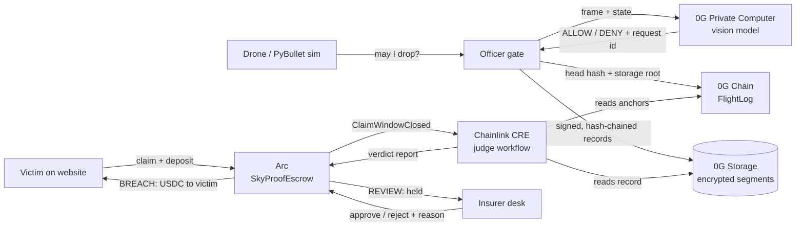

# SkyProof

**An independent, tamper-proof black box for delivery drones, with automatic payouts when a drone breaks the rules.**

**0G decides and records. Chainlink judges. Arc pays.**

ETHGlobal Mumbai · 5–7 Nov 2026 · Tracks: **0G Physical AI** · **Arc: Advanced Stablecoin Logic (Arc Studio)** · **Chainlink: Best workflow with CRE**

> **Hosted demo:** _add the Vercel link here after deploying_ · Live flights and claims run against the team's flight computer (see [Try it](#try-it-for-judges)).

---

## Contents
1. [The problem](#the-problem)
2. [What SkyProof does](#what-skyproof-does)
3. [Try it (for judges)](#try-it-for-judges)
4. [How each sponsor is used](#how-each-sponsor-is-used)
5. [Deployed contracts and on-chain proof](#deployed-contracts-and-on-chain-proof)
6. [Architecture and repo layout](#architecture-and-repo-layout)
7. [Run it locally](#run-it-locally)
8. [Host it (Vercel + your laptop)](#host-it-vercel--your-laptop)
9. [Security model](#security-model)
10. [Tests](#tests)
11. [Known limitations (honest list)](#known-limitations-honest-list)
12. [Docs, credits and AI usage](#docs-credits-and-ai-usage)

---

## The problem

Drones already make safety-critical decisions on their own: when to drop a package, whether to land, how to avoid an obstacle. When something goes wrong, **the only flight log belongs to the operator being investigated**, and it can be edited, lost or withheld.

Real example: in July 2019 a drone filming a festival in Barcarès, France, fell on the crowd and injured 3 people. The operator blamed a "battery failure". The French investigators (BEA, report 2019-0416) could not check that story, because *"the flight logs were no longer present on the drone, the pilot's tablet or the cameraman's phone."*

A victim today has to trust the operator's own record, then fight for compensation.

## What SkyProof does

| Step | Who | What happens |
|---|---|---|
| 1. **Decide** | **0G Private Computer** | Before every take-off, drop, landing or reroute, the drone sends its camera frame and state to a 0G vision model. The drone acts only on a fresh ALLOW for that exact request. |
| 2. **Record** | **0G Storage + 0G Chain** | Every decision, action and sensor sample goes into a signed, hash-chained record. Every ~15 s the new records are encrypted and uploaded to 0G Storage, and their fingerprint is anchored on 0G Chain. |
| 3. **Report** | **Victim** (website) | Someone hurt or with damaged property files a claim on Arc, with a description and photos and a 1 USDC refundable deposit. |
| 4. **Judge** | **Chainlink CRE** | After a 2-minute claim window, a CRE workflow finds the flight on 0G Chain, checks the record against its anchors, applies six objective rules and checks the weather independently. |
| 5. **Pay** | **Arc** (USDC escrow) | **Rule broken → the operator's USDC bond pays the victim automatically.** No rule broken → the money is held and an insurer decides, with a written reason the victim can read. |



**Without 0G the drone cannot act, and nobody can prove what it decided. Without Chainlink there is no neutral judge. Without Arc there is no automatic payout.**

---

## Try it (for judges)

Everything below works from the hosted site. The flight computer runs on the team's laptop during judging, so the **Live** and **claim** parts need it to be online.

### Path 1: Watch the drone decide (0G)
1. Open **Live** (button at the top right).
2. Pick a scenario, e.g. **"Person in the drop zone"**, then press **Start flight**.
3. Watch the drone ask 0G before each move. At the drop a person walks in, so **0G says DENY** and the drone waits. Each decision shows its 0G request id and response time.
4. When it lands, the flight is sealed on 0G and appears under **For operators → Past flights**.

| Scenario | What it shows |
|---|---|
| Person in the drop zone | 0G vision says DENY until the person leaves |
| Normal delivery | every step approved by 0G |
| 0G link lost | no answer from 0G → pre-approved safe stop, recorded as "no 0G decision claimed" |
| Cheating operator | the gate is disabled and the drone flies through the airport → the record proves it |
| Drop zone blocked | 0G chooses what to do with the package |
| Full mission | crowd, crane, fake "safe" sign, emergency |

### Path 2: Check a record yourself (0G Chain)
**Home → "Don't trust us"**: your browser re-checks a sealed flight against the anchors on 0G Chain. Edit any line (forge an approval, fake the GPS, delete a record) and watch the check fail.

### Path 3: File a claim and get paid (Chainlink + Arc)
1. **Report a problem** → open **"How to test this (for judges)"**.
2. Install MetaMask. "Connect my wallet" adds **Arc Testnet**. Get test USDC from the [Circle faucet](https://faucet.circle.com) (USDC also pays gas on Arc).
3. Pick the **"cheating operator"** delivery (it broke a rule), describe what happened, add a photo if you like, and send.
4. After the 2-minute window, **the Chainlink check starts by itself**. The page turns **Approved → Paid** and USDC arrives in your wallet.
5. Pick an honest delivery instead and the claim goes to **For insurers** (held), where the record and the complaint are shown side by side.
6. **Track my claim** shows any claim's status in plain words (try `5` for paid, `4` for held).

---

## How each sponsor is used

### 0G: the brain and the black box

| 0G product | Role | Where in code |
|---|---|---|
| **Private Computer** (router `router-api.0g.ai`, model `qwen3.8-flash`) | Makes every mission decision (ALLOW/DENY) and resolves in-flight situations (pick an option). Each answer's request id, provider, model, latency, prompt hash and frame hash are recorded. | `officer/src/zg.ts`, `officer/src/server.ts` |
| **Storage** (indexer `indexer-storage-testnet-turbo.0g.ai`, official TS SDK) | Holds the flight record: segments encrypted with AES-256-GCM (one key per flight), uploaded **during** the flight every ~15 s. Replays are rebuilt by downloading from 0G. Victim evidence and insurer reasons are stored here too. | `officer/src/sealer.ts`, `officer/src/chain.ts`, `officer/src/crypto.ts`, `officer/src/evidence.ts` |
| **Chain** (Galileo, chain 16602) | `DroneRegistry`: airframe, signed permit, approved model and prompt hashes. `FlightLog`: `openFlight` → `anchor(head, storageRoot)` per segment → `closeFlight`. Anyone can compare a record with these anchors. | `contracts/contracts/*.sol`, `officer/src/setup-chain.ts` |

**The safety gate** (`sim/skyproof_sim/gate.py`) is what makes 0G load-bearing: an action needs a 0G answer that is **fresh (≤ 10 s), for this exact request (nonce + request hash), and used once**. Permit rules veto illegal options before 0G is asked, and a local person-detector can only make a decision *stricter*. If 0G does not answer in time, the drone does a pre-approved safe stop (hold → divert → land), recorded as `SAFE_STOP_LOCAL` with "no 0G decision claimed". It never invents an approval.

**Scale so far:** 33 published flights, 1,033 sealed records, 260 decisions by 0G.

### Chainlink CRE: the neutral judge

Workflow: `cre/judge/verdict/workflow.ts`, with the pure rules in `cre/judge/verdict/rules.ts`.

- **Trigger:** the `ClaimWindowClosed` event on the Arc escrow.
- **Finds the flight** for the airframe and incident time. It asks the operator's evidence host, verifies the answer on 0G Chain, and falls back to `openFlightOf` on 0G Chain if the host lies or is down.
- **Verifies the record itself:** the hash chain, the operator signature on every record, every 0G Chain anchor, that the record ends with `CLOSE`, and that the permit hash matches. The released record is not trusted.
- **Rules (objective):**

| Rule | Breach when |
|---|---|
| B1 Geofence | the drone left the permitted area or entered a no-fly zone (also checked *between* samples) |
| B2 Altitude | it flew above the permit ceiling |
| B3 Unapproved action | an action had no matching, fresh (≤ 10 s), single-use 0G approval |
| B4 Override on DENY | the operator overrode a 0G DENY |
| B5 Record broken | the record is missing, edited, unsigned, doesn't match its anchors, was never closed, or was withheld |
| B6 Unsafe wind launch | it took off in wind above the permit limit (recorded wind, **and independently Open-Meteo at the take-off hour**) |

- **Consensus:** each node downloads and checks the record. Only the compact result goes through consensus (`consensusIdenticalAggregation`).
- **Output:** a 128-byte report `(claimId, verdict, breachCode, reportHash)` delivered via the CRE forwarder to `SkyProofEscrow.onReport`.
- **Automation:** `officer/src/cre-runner.ts` watches Arc, warms the evidence host, runs the workflow for every closed claim window, and closes ended windows itself. Nobody types commands.
- Security review of this workflow, with the fix log: [`docs/CRE_Security_Audit_2026-11-06.md`](docs/CRE_Security_Audit_2026-11-06.md).

### Arc: stablecoin escrow built in Arc Studio

`SkyProofEscrow` ([Arc Studio project](https://studio.arc.io/share/sky-proof-escrow-contract-tzqdmj9nlm), source `contracts/arc/SkyProofEscrow.sol`), USDC on Arc Testnet:

| Logic | Detail |
|---|---|
| **Operator bond** | The operator locks USDC per airframe. A drone is **active only while bond ≥ payout cap**, so an under-insured drone cannot take claims. Bond withdrawals have a cooldown after the last claim. |
| **Payout cap** | 5 USDC per claim (set per airframe by the owner). |
| **Claim deposit** | 1 USDC, refunded on payout. It stops spam claims. |
| **Incident window** | 120 s. Claims from several victims of the same incident are grouped into one incident (`claimsInIncident` is sent to the judge). |
| **Verdict from Chainlink only** | `onReport` accepts reports only from the CRE forwarder. **BREACH →** cap paid from the bond plus the deposit refunded, in the same transaction. **REVIEW →** funds held. |
| **Human review** | The insurer can approve or reject held claims only (never undo an automatic payout). The written reason is signed and stored on 0G Storage. |
| **Timeout** | No decision within 30 days → anyone can expire the claim and the victim's deposit is returned. |

---

## Deployed contracts and on-chain proof

| Contract | Network | Address |
|---|---|---|
| DroneRegistry | 0G Galileo (16602) | [`0xC3e0C4a5848c6b8754820286AF9805F6c4ca1Adf`](https://chainscan-galileo.0g.ai/address/0xC3e0C4a5848c6b8754820286AF9805F6c4ca1Adf) |
| FlightLog | 0G Galileo (16602) | [`0x2E6F0f6f3121e3aA7984ffC292f80E75c937cBa5`](https://chainscan-galileo.0g.ai/address/0x2E6F0f6f3121e3aA7984ffC292f80E75c937cBa5) |
| SkyProofEscrow (Arc Studio) | Arc Testnet (5042002) | [`0x10daa2dbded35f0056be1dbdbee908a12e4644d8`](https://testnet.arcscan.app/address/0x10daa2dbded35f0056be1dbdbee908a12e4644d8) |
| CRE forwarder | Arc Testnet | `0x6E9EE680ef59ef64Aa8C7371279c27E496b5eDc1` |
| USDC | Arc Testnet | `0x3600000000000000000000000000000000000000` |
| Operator wallet (signs records, pays 0G gas) | 0G Galileo | [`0x69A5160E8bf27A2a9D8d17eaff0De079CfdFA12A`](https://chainscan-galileo.0g.ai/address/0x69A5160E8bf27A2a9D8d17eaff0De079CfdFA12A) |

**Verdicts written by the Chainlink workflow on Arc:**

| Claim | Flight | Verdict | Tx |
|---|---|---|---|
| #1 | cheating operator | **BREACH** (B1 geofence, B3 unapproved) → victim paid 5 USDC + deposit | [0xc996a439…](https://testnet.arcscan.app/tx/0xc996a439b0b1e7d0ebc7667992f3747863411c274218651d5932564eae675789) |
| #2 | honest flight | **REVIEW** → held for the insurer | [0xff9b97e4…](https://testnet.arcscan.app/tx/0xff9b97e456202c12b31f46f3fad6d093c677acab31bdb6bd4935626012a66cee) |
| #8 | honest flight (started from the website), judged by the auto-runner | **REVIEW** (34 records intact, wind 2.22 m/s) | [0xbb608b5e…](https://testnet.arcscan.app/tx/0xbb608b5ecaaca43fa562ade29b069d06eef680b6e3a1298ddefb4917ce78dc26) |
| #9 | same; the victim left, so the auto-runner closed the window itself | **REVIEW** | [0x8adcadd8…](https://testnet.arcscan.app/tx/0x8adcadd8456051dd7531e8c337aaa71a9127ea28290f2af4d8d65af8138173d6) |

Full proof pack with screenshots and logs: [`proofs/README.md`](proofs/README.md). 0G requirements mapped to proofs: [`docs/0G_Proof_Sheet.md`](docs/0G_Proof_Sheet.md). Your own 0G AI calls are visible on the 0G dashboard (pc.0g.ai → Console → Activity, key "Skyproof").

---

## Architecture and repo layout

| Folder | What | Stack |
|---|---|---|
| `sim/` | PyBullet drone, city, 6 scenarios, the safety gate, sensors | Python 3.12, PyBullet 3.2.7, gym-pybullet-drones |
| `officer/` | Flight computer service: permit rules, 0G calls, signed record chain, sealing to 0G Storage + Chain, evidence server, CRE auto-runner, website "Start flight" | TypeScript (Node 22+), ethers 6, `@0gfoundation/0g-storage-ts-sdk`, ws |
| `contracts/` | `DroneRegistry`, `FlightLog` (0G Galileo); `arc/SkyProofEscrow.sol` (Arc Studio) | Solidity, Hardhat |
| `cre/judge/` | Chainlink CRE judge workflow + rules + tests | TypeScript, Bun, CRE CLI v1.39 |
| `web/` | Website: report a claim, track it, insurer inbox, live console, replays, 3D story | Next.js 15, React 19, React Three Fiber, viem |
| `proofs/` | Screenshots + logs of every on-chain step | |
| `reports/flights/` | Plain-English summary of every sealed flight | |
| `docs/`, `specs/` | Build reports, audits, plans | |

**Services and ports**

| Service | Command (in `officer/`) | Port | Job |
|---|---|---|---|
| Officer | `pnpm officer` | 8787 (WebSocket) | the drone talks to it; the Live page watches it; starts flights for the website |
| Evidence server | `pnpm evidence` | 8788 (HTTP) | releases records to the judge, stores claim evidence and insurer reasons on 0G, serves newly published flights |
| CRE auto-runner | `pnpm cre-runner` | — | runs the Chainlink judge on every closed claim window |
| Website | `pnpm start` (in `web/`) | 3000 | the site |

---

## Run it locally

**Prerequisites:** Node 22+, pnpm, Python 3.12 (PyBullet builds from source on Windows: install the Microsoft C++ Build Tools), Bun and the [CRE CLI](https://docs.chain.link/cre) for the judge, MetaMask for claims.

```powershell
# 1. secrets (never committed)
copy .env.example .env                         # 0G key, wallets, Arc RPC
copy cre\judge\.env.example cre\judge\.env     # CRE_ETH_PRIVATE_KEY

# 2. install
cd officer; pnpm install; cd ..
cd web; pnpm install; cd ..
cd sim; py -3.12 -m venv .venv; .venv\Scripts\pip install -r requirements.txt
.venv\Scripts\pip install --no-deps -e third_party\gym-pybullet-drones; cd ..

# 3. one-time chain setup (already done for the deployed contracts above)
cd officer; pnpm setup-chain                   # 0G: register airframe, permit, model + prompts
pnpm arc-setup                                 # Arc: bind operator, lock the bond

# 4. run (four terminals)
cd officer; pnpm officer
cd officer; pnpm evidence
cd officer; pnpm cre-runner
cd web; pnpm build; pnpm start                 # http://localhost:3000
```

**Fly a mission:** use **Live → Start flight**, or from a terminal:
```powershell
cd sim; .venv\Scripts\python.exe mission.py --scenario people_below --gui
```

**Useful commands (in `officer/`)**

| Command | What |
|---|---|
| `pnpm replay <flight-id> [--tamper \| --delete]` | rebuild a flight from 0G Storage alone and verify it against 0G Chain (or prove tampering is caught) |
| `pnpm claim <flight-id>` | file a claim as the test victim and close the window from a script |
| `pnpm export-web` | publish sealed flights to the website |
| `pnpm summary <flight-id> \| --all` | write the plain-English flight summary |
| `ARC_BOND_USDC=30 npx tsx src/arc-setup.ts` | top up the operator's bond |

**Judge by hand** (what the auto-runner does):
```powershell
cd cre\judge
cre workflow simulate verdict --non-interactive --trigger-index 0 --evm-tx-hash <closeTx> --evm-event-index 0 --broadcast -T staging-settings
```

**Settings** (`.env`, see `.env.example`): 0G (`ZG_*`), wallets (`DEPLOYER_/OPERATOR_/VICTIM_PRIVATE_KEY`), Arc (`ARC_*`), and the website "Start flight" controls `DEMO_MAX_FLIGHTS` (default 30/day), `DEMO_PASSCODE` (optional) and `DEMO_START=off`.

---

## Host it (Vercel + your laptop)

The website is static and runs on Vercel. The flight computer stays on your laptop and is reached through VS Code port forwarding.

1. **VS Code → Ports →** forward **8787** and **8788**, then right-click each → **Port Visibility → Public**.
2. **Vercel → Import** this repo → **Root Directory `web`** (Next.js, default build).
3. **Environment variables:**

| Key | Value |
|---|---|
| `NEXT_PUBLIC_OFFICER_WS` | `wss://<id>-8787.<region>.devtunnels.ms` (note **wss**) |
| `NEXT_PUBLIC_EVIDENCE_URL` | `https://<id>-8788.<region>.devtunnels.ms` (no trailing slash) |
| `NEXT_PUBLIC_ARC_ESCROW` | optional, defaults to the escrow above |

4. Deploy. Keep the laptop on, VS Code open and the three officer services running.

Without the tunnel, the hosted site still shows every published flight, the "check it yourself" verification, claim tracking and the insurer inbox, because those read 0G and Arc directly. The Live page then says the flight computer is offline.

---

## Security model

| Threat | Protection |
|---|---|
| Operator edits or deletes the log | hash chain + operator signature per record; fingerprints anchored on 0G Chain during the flight; the judge re-checks everything |
| Operator withholds the record | missing, unreadable or unclosed record = breach **B5** (the victim is paid) |
| Fake or reused AI approval | the gate and the judge both require a fresh (≤ 10 s), single-use approval for that exact command |
| Fake verdict | the escrow accepts verdicts only from the Chainlink CRE forwarder |
| Spam claims | 1 USDC deposit; drone inactive when the bond is below the cap |
| Private flight data | segments are AES-256-GCM encrypted on 0G Storage; released only when a claim exists |
| Strangers using the public tunnel | only a simulator holding the per-run **drone token** can act as the drone; website starts limited to a fixed scenario list, one flight at a time, a daily cap and an optional passcode; no typed commands ever reach a shell; the evidence server serves only validated file names |
| Secrets | `.env`, `cre/judge/.env` and flight keys (`officer/.tmp/keys/`) are git-ignored; nothing secret is in the repo or the website |

---

## Tests

| Suite | Command | Result |
|---|---|---|
| Website (record verification, data mapping, UI logic) | `cd web; pnpm test` | 28 / 28 |
| Officer (tamper, forgery, permit, cheating-flight rules) | `cd officer; pnpm test` | 8 / 8 |
| CRE judge rules (all published flights + each fix) | `cd cre/judge/verdict; bun test` | 9 / 9 |
| Contracts (FlightLog) | `cd contracts; pnpm test` | 8 / 8 |
| Lint / types | `cd web; npx eslint src; npx tsc --noEmit` | clean |

End to end on testnet (7 Nov 2026): a flight started from the website (0G decided, 34 records sealed, published), then claims #8 and #9 judged automatically by Chainlink → REVIEW written to Arc.

---

## Known limitations (honest list)

- **0G compute is not TEE-attested.** Calls go through `router-api.0g.ai`; the dashboard shows the model served "via aliyun". The request ids are real 0G receipts, but we don't claim secure-enclave execution. Next step: the 0G serving-broker SDK with `processResponse()` verification, and the judge checking that proof per decision.
- **The CRE workflow runs as `cre workflow simulate --broadcast`**, because the account has no DON deploy access yet. The verdicts on Arc are real writes through the CRE forwarder.
- **Workflow ID / owner pinning is not set on the escrow** (the forwarder check is). Set `expectedWorkflowId/Owner` when the workflow is deployed to a DON.
- **The operator holds each flight's decryption key** and releases it via the evidence server. Next step: encrypt the key to the insurer/judge as well.
- **A slow evidence host counts as withholding (B5).** Before the warm-up fix, claims **#6 and #7 were wrongly paid** this way (record download from 0G Storage was slower than the judge's HTTP timeout). It's fixed (fast lookup + warm-up, verified on claims #8 and #9), but those two payouts are on-chain.
- **The record proves what the drone recorded and decided, not that its sensors told the truth.**
- **The live demo backend runs on a laptop** (VS Code tunnel). Replays, verification, tracking and the insurer inbox work without it.

---

## Docs, credits and AI usage

- Explainer of the current system: [`docs/SkyProof_Explained_Current.md`](docs/SkyProof_Explained_Current.md)
- CRE security audit + fix log: [`docs/CRE_Security_Audit_2026-11-06.md`](docs/CRE_Security_Audit_2026-11-06.md)
- Arc review: [`docs/Arc_Review_2026-11-06.md`](docs/Arc_Review_2026-11-06.md)
- 0G proof sheet and pitch: [`docs/0G_Proof_Sheet.md`](docs/0G_Proof_Sheet.md), [`docs/Pitch_0G.md`](docs/Pitch_0G.md)
- UI plans: [`specs/06-simple-ui-plan.md`](specs/06-simple-ui-plan.md), [`docs/UX_Plan_End_Users.md`](docs/UX_Plan_End_Users.md)
- Third-party assets and licences: [`CREDITS.md`](CREDITS.md)
- How AI tools were used in this build: [`AI_USAGE.md`](AI_USAGE.md)
