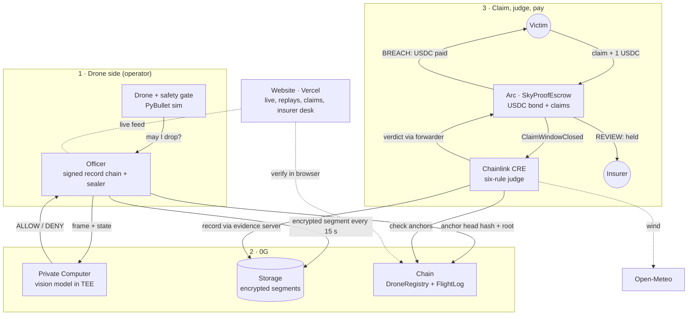
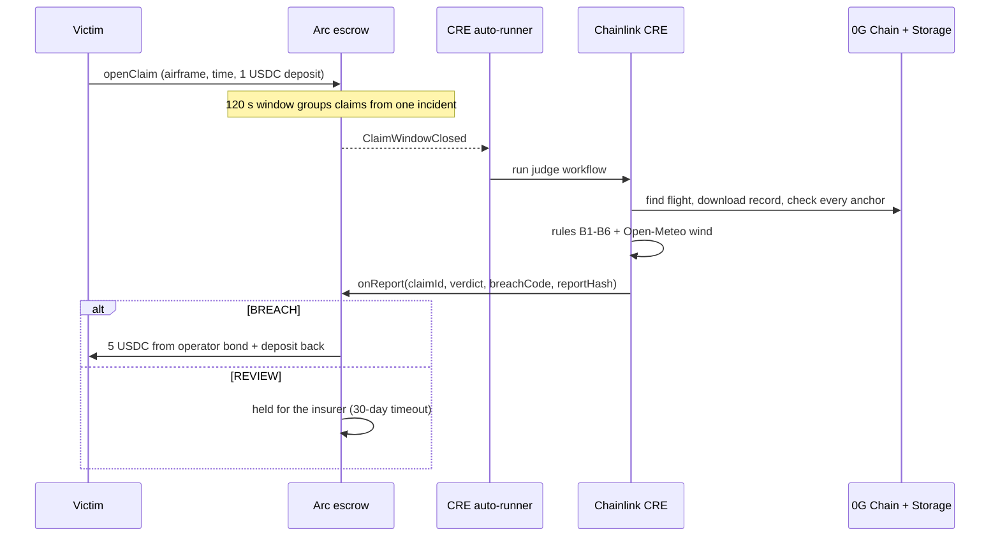

# SkyProof

**A tamper-proof black box for autonomous drones, with automatic payouts when a drone breaks the rules.**

**0G decides and records. Chainlink judges. Arc pays.**

ETHGlobal Mumbai 2026 · **0G Physical AI** · **Arc: Advanced Stablecoin Logic (Arc Studio)** · **Chainlink: Best workflow with CRE**

**Live site: https://sky-proof.vercel.app** · The demo uses a delivery drone. The same setup works for any autonomous drone (spraying, inspection, filming); only the permit and the list of gated actions change.

---

## The problem

When an autonomous drone hurts someone, **the only flight log belongs to the operator**. That log can be edited, lost or withheld.

In 2019 a drone fell on a festival crowd in Barcarès, France, and injured 3 people. The French investigators (BEA, report 2019-0416) could not check the operator's "battery failure" story: *"the flight logs were no longer present on the drone, the pilot's tablet or the cameraman's phone."*

## How it works

| Step | Sponsor | What happens |
|---|---|---|
| **Decide** | 0G Private Computer | Before every take-off, drop, landing or reroute, the drone sends its camera frame to a 0G vision model running in a TEE (Intel TDX). It acts only on a fresh ALLOW for that exact request. |
| **Record** | 0G Storage + 0G Chain | Every decision and sensor sample goes into a signed, hash-chained record. Every 15 s new records are encrypted (AES-256-GCM) to 0G Storage and their fingerprint is anchored on 0G Chain. |
| **Report** | Arc | A victim files a claim on the website with a 1 USDC refundable deposit. |
| **Judge** | Chainlink CRE | After the 2-minute claim window, a CRE workflow re-verifies the record against 0G Chain, applies six rules and checks the wind on Open-Meteo. |
| **Pay** | Arc | **Rule broken:** the operator's USDC bond pays the victim automatically. **No rule broken:** the claim is held for an insurer, who must give a written reason. |

## Architecture



### Claim flow



## Try it

Everything is on the [live site](https://sky-proof.vercel.app). **Live** and **claims** need the team's flight computer to be online (it runs on a laptop behind a VS Code tunnel). Replays, record checks, tracking and the insurer desk work without it.

1. **Watch the drone decide (0G):** open **Live**, pick **Person in the drop zone**, press **Start flight**. 0G says DENY until the person leaves. Each decision shows its 0G request id and TEE attestation.
2. **Try to cheat (0G Chain):** on the home page, **Try to cheat** re-checks a sealed flight in your browser against 0G Chain. Forge an approval, fake the GPS or delete a record, and the check fails.
3. **Get paid (Chainlink + Arc):** **Report a problem** → connect MetaMask (Arc Testnet is added for you; test USDC from the [Circle faucet](https://faucet.circle.com)) → pick the **cheating operator** delivery → send. About 4 minutes after the window closes the page shows **Paid**. Pick an honest delivery instead and the claim goes to **For insurers**.
4. **Track my claim:** enter a claim number (e.g. `10` paid, `8` held).

Live scenarios: normal delivery · person in the drop zone · 0G link lost (safe stop, no fake approval) · cheating operator · drop zone blocked · full mission.

## Sponsor details

### 0G
- **Private Computer:** router `router-api.0g.ai`, model `0gm-1.0-35b-a3b` (TEE: Intel TDX, verified by dstack, sealed channel `x-0g-e2ee`). Each decision records its request id, model, latency, prompt and frame hashes, and the attestation. Code: `officer/src/zg.ts`.
- **Safety gate** (`sim/skyproof_sim/gate.py`): an action needs a 0G ALLOW that is **fresh (≤ 10 s), for this exact request, used once**. If 0G does not answer, the drone does a pre-approved safe stop and records "no 0G decision claimed". It never invents an approval.
- **Storage:** encrypted segments uploaded during the flight with the official TS SDK. Replays are rebuilt from 0G alone (`pnpm replay <flight>`). Code: `officer/src/sealer.ts`, `officer/src/crypto.ts`.
- **Chain** (Galileo 16602): `DroneRegistry` (airframe, permit, approved model) and `FlightLog` (`openFlight` → `anchor` per segment → `closeFlight`).
- **So far:** 47 flights published, 1,529 sealed records, 360 decisions by 0G.

### Chainlink CRE
Workflow `cre/judge/verdict/workflow.ts`, rules in `rules.ts`. Triggered by `ClaimWindowClosed` on Arc. It finds the flight (falling back to 0G Chain if the evidence host lies), then verifies the hash chain, signatures, every anchor and the `CLOSE` record before applying the rules. Only the compact result goes through consensus (`consensusIdenticalAggregation`).

| Rule | Breach when |
|---|---|
| B1 Geofence | left the permitted area or entered a no-fly zone |
| B2 Altitude | flew above the permit ceiling |
| B3 Unapproved action | acted without a matching, fresh, single-use 0G approval |
| B4 Override | overrode a 0G DENY |
| B5 Record broken | record missing, edited, unsigned, not matching its anchors, not closed, or withheld |
| B6 Wind | took off above the wind limit (recorded wind **and** Open-Meteo) |

`officer/src/cre-runner.ts` runs the workflow automatically for every closed claim window. Security review: [`docs/CRE_Security_Audit_2026-11-06.md`](docs/CRE_Security_Audit_2026-11-06.md).

### Arc
`SkyProofEscrow`, built in [Arc Studio](https://studio.arc.io/share/sky-proof-escrow-contract-tzqdmj9nlm) (`contracts/arc/SkyProofEscrow.sol`), USDC on Arc Testnet:
- **Operator bond** per airframe. A drone is active only while bond ≥ payout cap (5 USDC). Withdrawals have a cooldown.
- **Claims:** 1 USDC deposit (refunded on payout); a 120 s window groups victims of the same incident.
- **Verdicts only from the Chainlink CRE forwarder.** BREACH pays the cap and refunds the deposit in one transaction.
- **Insurer** can only approve or reject held claims, never undo an automatic payout. The reason is stored on 0G Storage.
- **Timeouts:** no verdict within 7 days, or no insurer decision within 30 days → anyone can expire the claim and the deposit goes back to the victim.

## Deployed contracts

| Contract | Network | Address |
|---|---|---|
| DroneRegistry | 0G Galileo | [`0xC3e0C4a5848c6b8754820286AF9805F6c4ca1Adf`](https://chainscan-galileo.0g.ai/address/0xC3e0C4a5848c6b8754820286AF9805F6c4ca1Adf) |
| FlightLog | 0G Galileo | [`0x2E6F0f6f3121e3aA7984ffC292f80E75c937cBa5`](https://chainscan-galileo.0g.ai/address/0x2E6F0f6f3121e3aA7984ffC292f80E75c937cBa5) |
| SkyProofEscrow | Arc Testnet | [`0x10daa2dbded35f0056be1dbdbee908a12e4644d8`](https://testnet.arcscan.app/address/0x10daa2dbded35f0056be1dbdbee908a12e4644d8) |
| CRE forwarder | Arc Testnet | `0x6E9EE680ef59ef64Aa8C7371279c27E496b5eDc1` |
| Operator wallet | 0G Galileo | [`0x69A5160E8bf27A2a9D8d17eaff0De079CfdFA12A`](https://chainscan-galileo.0g.ai/address/0x69A5160E8bf27A2a9D8d17eaff0De079CfdFA12A) |

**Verdicts written by Chainlink on Arc**

| Claim | Flight | Verdict | Tx |
|---|---|---|---|
| #1 | cheating operator | BREACH → paid | [0xc996a439…](https://testnet.arcscan.app/tx/0xc996a439b0b1e7d0ebc7667992f3747863411c274218651d5932564eae675789) |
| #2 | honest | REVIEW → held | [0xff9b97e4…](https://testnet.arcscan.app/tx/0xff9b97e456202c12b31f46f3fad6d093c677acab31bdb6bd4935626012a66cee) |
| #8 | honest, auto-runner | REVIEW | [0xbb608b5e…](https://testnet.arcscan.app/tx/0xbb608b5ecaaca43fa562ade29b069d06eef680b6e3a1298ddefb4917ce78dc26) |
| #10 | cheating operator, started from the public site | BREACH → paid | [0x0f081515…](https://testnet.arcscan.app/tx/0x0f081515ef0436305d01c6697e09f19d94049fae75017187991ec48c7546f256) |
| #11 | cheating operator, auto-runner | BREACH → paid | [0x9cdaa4d5…](https://testnet.arcscan.app/tx/0x9cdaa4d550769714e600eada01874be4b994b228402af7afb548bb61b7f3d0f6) |

More: [`docs/Deployments.md`](docs/Deployments.md) · proof pack [`proofs/README.md`](proofs/README.md) · [`docs/0G_Proof_Sheet.md`](docs/0G_Proof_Sheet.md)

## Repo layout

| Folder | What | Stack |
|---|---|---|
| `sim/` | drone, city, scenarios, safety gate | Python 3.12, PyBullet |
| `officer/` | flight computer: 0G calls, record chain, sealer, evidence server, CRE auto-runner | TypeScript, Node 22, ethers 6, 0G Storage SDK |
| `contracts/` | `DroneRegistry`, `FlightLog` (0G); `arc/SkyProofEscrow.sol` (Arc Studio) | Solidity, Hardhat |
| `cre/judge/` | Chainlink CRE judge workflow + rules | TypeScript, Bun, CRE CLI v1.39 |
| `web/` | website | Next.js 15, React 19, React Three Fiber, viem |

## Run it locally

Needs Node 22+, pnpm, Python 3.12, Bun + the [CRE CLI](https://docs.chain.link/cre), MetaMask.

```powershell
copy .env.example .env; copy cre\judge\.env.example cre\judge\.env   # secrets, never committed
cd officer; pnpm install; cd ..\web; pnpm install; cd ..
cd sim; py -3.12 -m venv .venv; .venv\Scripts\pip install -r requirements.txt
.venv\Scripts\pip install --no-deps -e third_party\gym-pybullet-drones; cd ..

# one-time chain setup (already done for the contracts above)
cd officer; pnpm setup-chain; pnpm arc-setup

# run: four terminals
cd officer; pnpm officer       # :8787 WebSocket, drone + live page
cd officer; pnpm evidence      # :8788 HTTP, records for the judge
cd officer; pnpm cre-runner    # runs the Chainlink judge automatically
cd web; pnpm build; pnpm start # :3000
```

Useful (in `officer/`): `pnpm replay <flight> [--tamper|--delete]` · `pnpm claim <flight>` · `pnpm export-web` · `pnpm summary --all` · top up the bond with `ARC_BOND_USDC=30 npx tsx src/arc-setup.ts`.

**Hosting:** the website runs on Vercel (root `web`). Forward ports 8787 and 8788 publicly from VS Code and set `NEXT_PUBLIC_OFFICER_WS` (wss://…-8787…) and `NEXT_PUBLIC_EVIDENCE_URL` (https://…-8788…). Details: [`docs/Setup.md`](docs/Setup.md).

## Tests

| Suite | Command | Result |
|---|---|---|
| Website | `cd web; pnpm test` | 28 / 28 |
| Officer | `cd officer; pnpm test` | 8 / 8 |
| CRE rules | `cd cre/judge/verdict; bun test` | 9 / 9 |
| Contracts | `cd contracts; pnpm test` | 8 / 8 |
| Lint + types | `cd web; npx eslint src; npx tsc --noEmit` | clean |

## Security

- **Edited or deleted log:** caught by the hash chain, per-record signatures and the 0G Chain anchors, all re-checked by the judge.
- **Withheld log:** counts as breach B5, so the victim is paid.
- **Fake or reused AI approval:** the gate and the judge both need a fresh, single-use approval for that exact command.
- **Fake verdict:** the escrow accepts verdicts only from the CRE forwarder.
- **Spam claims:** blocked by the 1 USDC deposit.
- **Public tunnel:** a fixed scenario list, one flight at a time, a daily cap, and a per-run drone token. No typed command reaches a shell.
- **Secrets:** `.env` files and flight keys are git-ignored.

## Known limitations

- **TEE checks:** decisions use a TEE-attested 0G provider over a sealed channel, but we don't yet re-verify each response's enclave signature ourselves.
- **CRE deployment:** the workflow runs as `cre workflow simulate --broadcast` (no DON deploy access yet). Its verdicts are real writes through the CRE forwarder. Workflow-ID pinning on the escrow is off until it is deployed to a DON.
- **Decryption key:** the operator holds each flight's key and releases it through the evidence server.
- **Slow evidence host:** a host that answers too slowly counts as withholding (B5). Before a warm-up fix, claims #6 and #7 were paid this way.
- **Sensors:** the record proves what the drone recorded and decided, not that its sensors were honest.
- **Hosting:** the live backend runs on a laptop.

## Docs

[PRD](docs/PRD.md) · [TRD](docs/TRD.md) · [Architecture](docs/Architecture.md) · [Sponsor tracks](docs/Sponsor_Tracks.md) · [Sponsors](docs/Sponsors.md) · [Setup](docs/Setup.md) · [Deployments](docs/Deployments.md) · [Implementation plan](docs/Implementation_Plan.md) · [E2E test report](docs/E2E_Test_Report_2026-11-07.md) · [Credits](CREDITS.md) · [AI usage](AI_USAGE.md) · [CLAUDE.md](CLAUDE.md) / [AGENTS.md](AGENTS.md)
