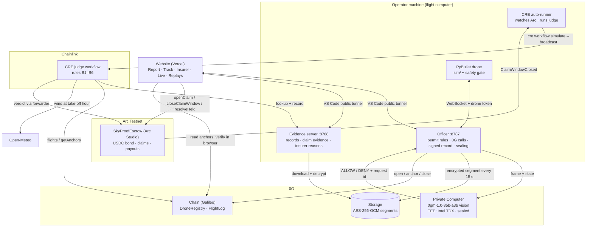
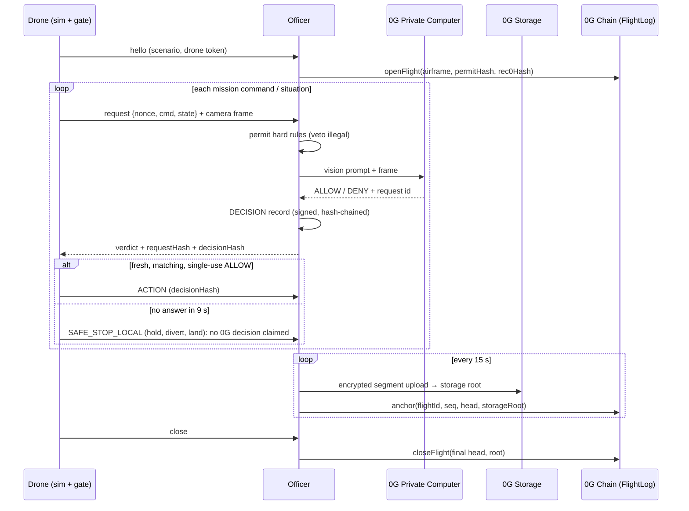
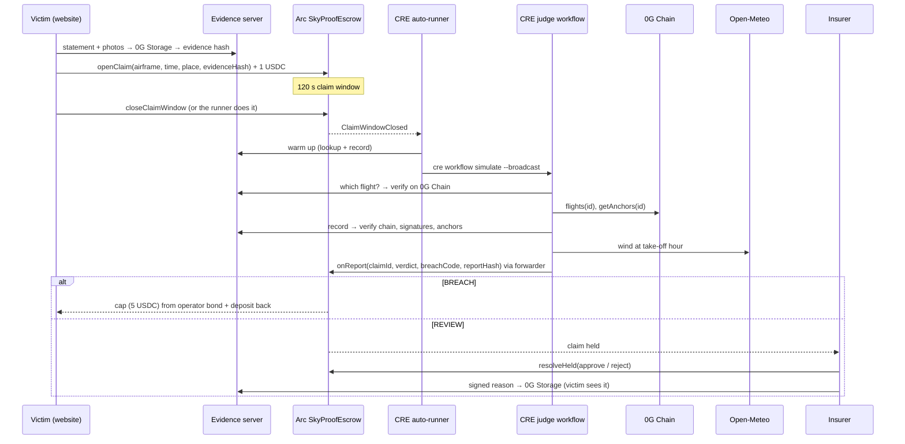

# SkyProof: Architecture

Related: [TRD](TRD.md) (details) · [Deployments](Deployments.md) (addresses)

## 1. System overview



## 2. One flight (decide → record → seal)



## 3. One claim (report → judge → pay)



## 4. Trust boundaries

| Party | Trusted for | Not trusted for (checked instead) |
|---|---|---|
| Operator / officer | running the flight, holding the decryption key | the record content: hash chain + signature + 0G Chain anchors |
| Evidence server | availability | which flight (verified on 0G Chain) and the record (verified per record); withholding = B5 |
| 0G Private Computer | the decision itself (receipt = request id) | provider is TEE-attested (TDX, dstack) and the channel sealed, both recorded; per-response enclave signatures not yet re-verified |
| CRE workflow | rules + consensus | — |
| CRE forwarder | delivering the report | escrow accepts only the forwarder |
| Insurer | held claims only | cannot undo automatic payouts; reason is public |
| Website | presentation | every check (verify, track) reads chain data directly |

## 5. Data locations

| Data | Where | Format |
|---|---|---|
| Flight record (authoritative) | 0G Storage | AES-256-GCM JSONL segments; root per segment |
| Fingerprints | 0G Chain `FlightLog` | head hash + storage root per anchor |
| Working copy | `officer/.tmp/flights/<id>.jsonl` + `.manifest.json` | plain (git-ignored) |
| Decryption keys | `officer/.tmp/keys/<id>.key` | git-ignored |
| Published flights | `web/public/data/flights/` + `/site/flights/` on the evidence server | JSON, summary text |
| Claims, verdicts, payouts | Arc `SkyProofEscrow` | on-chain state + events |
| Victim evidence, insurer reasons | 0G Storage (+ cache in `officer/.tmp/claims/`) | JSON bundle; fingerprint on Arc |

## 6. Deployment topology

```
Judge's browser ──https──▶ Vercel (static Next.js site)
        │                         │ build-time env: tunnel URLs
        ├─wss──▶ devtunnels ──▶ laptop :8787 officer ──▶ sim (spawned)
        ├─https─▶ devtunnels ──▶ laptop :8788 evidence server
        ├─https─▶ 0G Galileo RPC (verify anchors in the browser)
        └─https─▶ Arc RPC + MetaMask (claims)
laptop: cre-runner ──▶ CRE CLI ──▶ Arc forwarder
```
